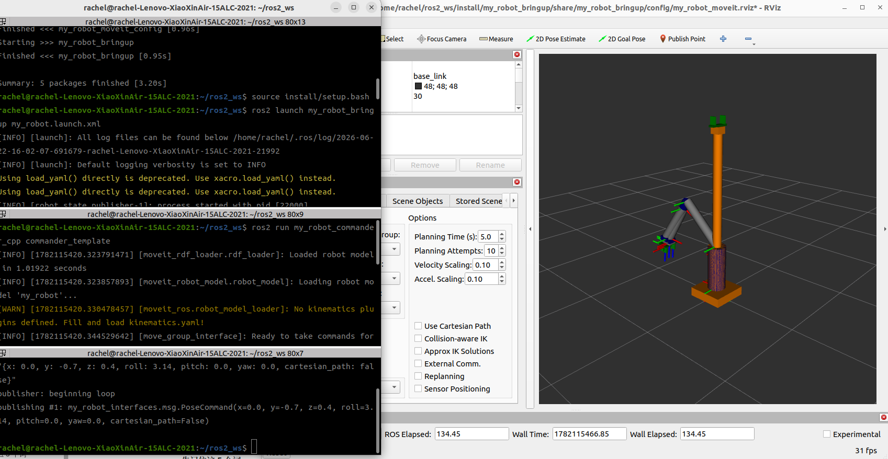
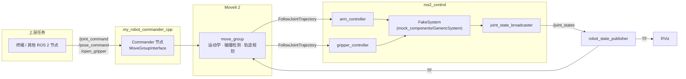
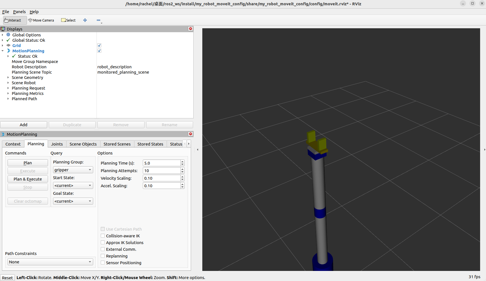

<div align="center">

# ArmPilot-ROS2

**基于 ROS 2 Humble 与 MoveIt 2 的六自由度机械臂 + 夹爪运动规划与控制仿真系统**


</div>

从零搭建一套完整的机械臂控制链路：**URDF/Xacro 建模 → MoveIt 2 运动规划 → ros2_control 轨迹执行 → C++ Commander 节点通过 ROS 2 话题接收外部指令**。当前使用 `mock_components/GenericSystem`（FakeSystem）作为仿真硬件，在 RViz 中完成规划与执行。

<p align="center">
  
  <br><sub>通过 <code>/pose_command</code> 话题发送末端位姿，Commander 调用 MoveIt 规划并执行</sub>
</p>

---

## 目录

- [功能特性](#功能特性)
- [系统架构](#系统架构)
- [项目结构](#项目结构)
- [环境要求](#环境要求)
- [快速开始](#快速开始)
- [话题接口](#话题接口)
- [机器人模型说明](#机器人模型说明)
- [踩坑记录](#踩坑记录)
- [后续计划](#后续计划)
- [详细教程](#详细教程)

## 功能特性

- **机器人建模**：使用 URDF/Xacro 描述六自由度机械臂与平行夹爪，拆分为 `arm` / `gripper` / `common_properties` / `ros2_control` 多个模块，并添加简化的碰撞模型。
- **MoveIt 2 配置**：通过 Setup Assistant 生成 `arm`、`gripper` 两个规划组、末端执行器、命名姿态（`home`、`pose_1`、`pose_2`、`gripper_open`、`gripper_closed` 等）和碰撞矩阵。
- **ros2_control 执行**：`arm_controller` 与 `gripper_controller`（`JointTrajectoryController`）+ `joint_state_broadcaster`，由 MoveIt 通过 `FollowJointTrajectory` Action 下发轨迹。
- **统一启动**：独立的 `my_robot_bringup` 功能包，一条命令启动 robot_state_publisher、控制器、move_group 和 RViz。
- **MoveIt C++ API**：封装 `Commander` 类，支持
  - 命名姿态目标（Named Target）
  - 关节空间目标（Joint Target，正运动学方向）
  - 末端位姿目标（Pose Target，由 MoveIt 求逆解）
  - 笛卡尔直线路径（`computeCartesianPath`）
  - 夹爪开合
- **话题驱动控制**：Commander 订阅 `/joint_command`、`/pose_command`、`/open_gripper`，外部节点或终端即可驱动机械臂。
- **自定义消息接口**：`my_robot_interfaces/msg/PoseCommand`。

## 系统架构



**控制链路**：外部节点 → Commander → MoveIt → ros2_control → Hardware
**状态反馈链路**：Hardware → ros2_control → `/joint_states` → robot_state_publisher → TF → MoveIt / RViz

> MoveIt 只负责"怎么动"（规划），不直接驱动电机；ros2_control 的控制器负责"真正去动"。接入真实机械臂时，只需把 FakeSystem 替换为厂商的硬件接口与驱动，上层规划和 Commander 逻辑基本不变。

## 项目结构

```text
ros2_ws/src/
├── my_robot_description/        # 机器人模型
│   ├── urdf/
│   │   ├── my_robot.urdf.xacro       # 入口：组合机械臂 + 夹爪 + ros2_control
│   │   ├── arm.xacro                 # 六轴机械臂连杆与关节
│   │   ├── gripper.xacro             # 平行夹爪（mimic 关节）
│   │   ├── common_properties.xacro   # 材质等公共属性
│   │   ├── my_robot.ros2_control.xacro
│   │   └── arm.urdf                  # 最初的纯 URDF 版本
│   ├── launch/display.launch.xml     # 模型可视化
│   └── rviz/urdf_config.rviz
├── my_robot_moveit_config/      # MoveIt Setup Assistant 生成的配置包
│   ├── config/                       # SRDF、joint_limits、kinematics、控制器配置等
│   └── launch/                       # demo.launch.py、move_group.launch.py 等
├── my_robot_bringup/            # 统一启动
│   ├── launch/my_robot.launch.xml
│   └── config/                       # ros2_controllers.yaml、RViz 配置
├── my_robot_commander_cpp/      # MoveIt C++ API 控制节点
│   └── src/
│       ├── test_moveit.cpp           # 基础 API 测试（命名/关节/位姿/笛卡尔）
│       └── commander_template.cpp    # Commander 类 + 话题订阅
└── my_robot_interfaces/         # 自定义消息
    └── msg/PoseCommand.msg
```

## 环境要求

| 依赖 | 版本 |
| --- | --- |
| Ubuntu | 22.04 |
| ROS 2 | Humble |
| MoveIt 2 | Humble |
| 构建工具 | colcon |

安装主要依赖：

```bash
sudo apt install ros-humble-moveit ros-humble-ros2-control ros-humble-ros2-controllers \
                 ros-humble-joint-state-publisher-gui ros-humble-xacro ros-humble-urdf-tutorial
```

> ⚠️ **工作空间请放在纯英文路径下**（例如 `~/ros2_ws`）。路径中含中文（如 `~/桌面`）会导致 `rosidl` 生成自定义消息时失败，详见[踩坑记录](#踩坑记录)。

## 快速开始

### 1. 克隆并构建

```bash
git clone https://github.com/<your-username>/armpilot-ros2.git
cp -r armpilot-ros2/ros2_ws ~/ros2_ws
cd ~/ros2_ws
source /opt/ros/humble/setup.bash
colcon build
source install/setup.bash
```

### 2. 仅查看模型

```bash
ros2 launch my_robot_description display.launch.xml
```

### 3. MoveIt Demo（RViz 中拖动末端手动规划）

```bash
ros2 launch my_robot_moveit_config demo.launch.py
```

<p align="center">
  
</p>

### 4. 完整系统 + Commander 节点

终端 1 —— 启动机器人、控制器、MoveIt 与 RViz：

```bash
ros2 launch my_robot_bringup my_robot.launch.xml
```

终端 2 —— 启动 Commander 控制节点：

```bash
ros2 run my_robot_commander_cpp commander_template
```

终端 3 —— 发送控制指令（见下方[话题接口](#话题接口)）。

## 话题接口

Commander 节点订阅以下话题：

| 话题 | 消息类型 | 作用 |
| --- | --- | --- |
| `/open_gripper` | `example_interfaces/msg/Bool` | `true` 打开夹爪，`false` 关闭夹爪 |
| `/joint_command` | `example_interfaces/msg/Float64MultiArray` | 6 个关节目标角度（rad） |
| `/pose_command` | `my_robot_interfaces/msg/PoseCommand` | 末端位姿目标，可选笛卡尔直线路径 |

`PoseCommand.msg`：

```text
float64 x
float64 y
float64 z
float64 roll
float64 pitch
float64 yaw
bool cartesian_path   # false: 普通位姿规划；true: 笛卡尔直线路径
```

示例：

```bash
# 关节空间目标
ros2 topic pub --once /joint_command example_interfaces/msg/Float64MultiArray \
  "{data: [1.5, 0.5, 0.0, 1.5, 0.0, -0.7]}"

# 末端位姿目标（相对 base_link）
ros2 topic pub --once /pose_command my_robot_interfaces/msg/PoseCommand \
  "{x: 0.0, y: -0.7, z: 0.4, roll: 3.14, pitch: 0.0, yaw: 0.0, cartesian_path: false}"

# 夹爪开 / 合
ros2 topic pub --once /open_gripper example_interfaces/msg/Bool "{data: true}"
ros2 topic pub --once /open_gripper example_interfaces/msg/Bool "{data: false}"
```

## 机器人模型说明

| 关节 | 类型 | 旋转轴 | 范围 |
| --- | --- | --- | --- |
| `joint1` | revolute | z | −3.14 ~ 3.14 rad |
| `joint2` | revolute | y | 0 ~ 2.5 rad |
| `joint3` | revolute | y | 0 ~ 2.5 rad |
| `joint4` | revolute | z | −3.14 ~ 3.14 rad |
| `joint5` | revolute | y | −1.57 ~ 1.57 rad |
| `joint6` | continuous | z | — |
| `gripper_left_finger_joint` | prismatic | x | 0 ~ 0.06 m |
| `gripper_right_finger_joint` | prismatic（mimic 左指，系数 −1） | x | −0.06 ~ 0 m |

模型由简单几何体（box / cylinder）组成，碰撞模型统一简化为立方体以降低碰撞检测开销。实际工程中通常由 SolidWorks 等 CAD 软件配合 `sw2urdf` 插件导出。

## 踩坑记录

<details>
<summary><b>1. <code>demo.launch.py</code> 启动报错、RViz 中无模型</b></summary>

Setup Assistant 生成的 `config/joint_limits.yaml` 中 `max_velocity` / `max_acceleration` 为整数（如 `1`），而参数要求为 double。改为浮点数（`1.0`）并将 `has_velocity_limits` / `has_acceleration_limits` 设为 `true` 即可。
</details>

<details>
<summary><b>2. Plan 成功但 Execute 失败</b></summary>

生成的 `config/moveit_controllers.yaml` 中控制器缺少 `action_ns` 与 `default` 字段，MoveIt 找不到对应的 `FollowJointTrajectory` Action。为每个控制器补充：

```yaml
    action_ns: follow_joint_trajectory
    default: true
```

添加夹爪后，还需要把 `gripper_controller` 加入 `controller_names` 并配置对应关节。
</details>

<details>
<summary><b>3. 自定义消息包构建失败（中文路径）</b></summary>

工作空间位于 `~/桌面/ros2_ws` 时，`rosidl` 在生成 `PoseCommand.msg` 的中间 `.idl` 文件时会把含 Unicode 的绝对路径解析错误。解决方法是把工作空间迁移到纯英文路径，桌面上只保留软链接：

```bash
mv ~/桌面/ros2_ws ~/ros2_ws
ln -s ~/ros2_ws ~/桌面/ros2_ws
cd ~/ros2_ws && rm -rf build install log && colcon build
```

之后构建、运行、`source` 一律使用 `~/ros2_ws`。
</details>

<details>
<summary><b>4. bringup 中 ros2_control_node 拿不到 robot_description</b></summary>

在 `my_robot.launch.xml` 中为 `ros2_control_node` 添加重映射：

```xml
<remap from="~/robot_description" to="/robot_description" />
```
</details>

<details>
<summary><b>5. Humble 下无法安装 moveit_py</b></summary>

ROS 2 Humble 没有提供 `moveit_py` 的二进制包，因此本项目使用 C++ `MoveGroupInterface`。如需 Python API，可迁移到 Ubuntu 24.04 + ROS 2 Jazzy。
</details>

## 后续计划

- [ ] 接入 Gazebo 等仿真器中的机械臂
- [ ] 加入视觉识别模块，由 Python 节点计算抓取位姿并发布到 `/pose_command`
- [ ] 实现完整的抓取—放置任务流程
- [ ] 将 FakeSystem 替换为真实机械臂的硬件接口与驱动

## 详细教程

完整的搭建过程、每一步的配置截图、代码迭代过程以及 ROS 2 / MoveIt / ros2_control 概念说明，见 [NOTES.md](NOTES.md)。

